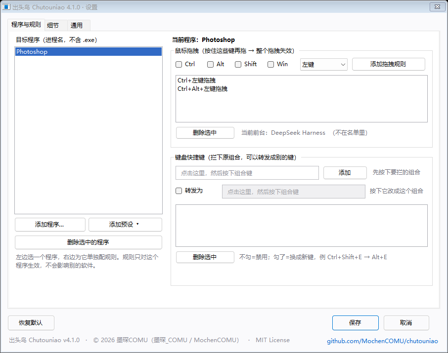
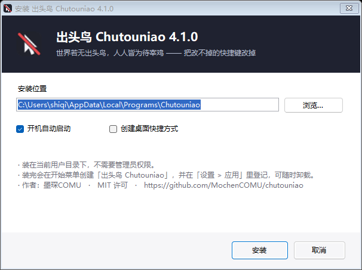
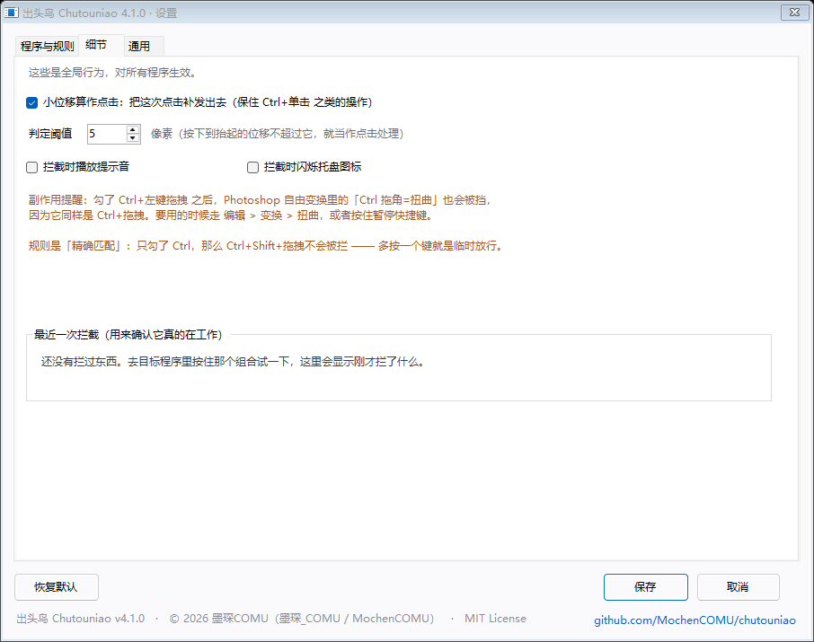
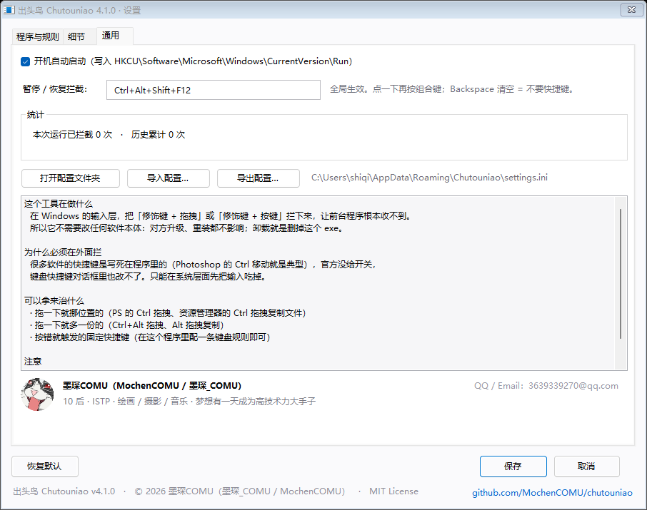
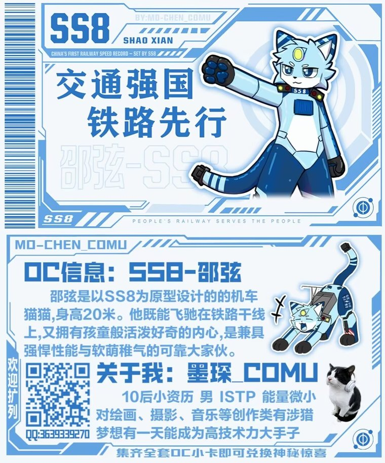
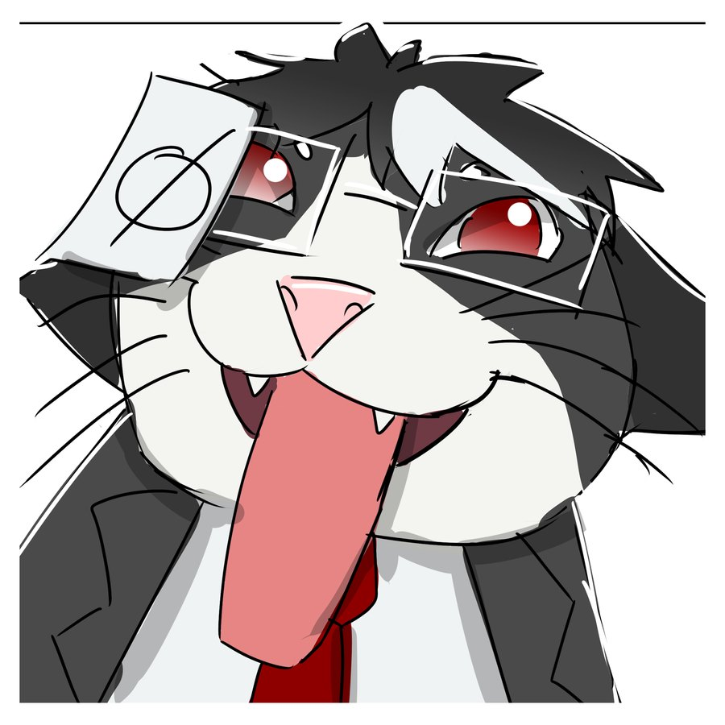
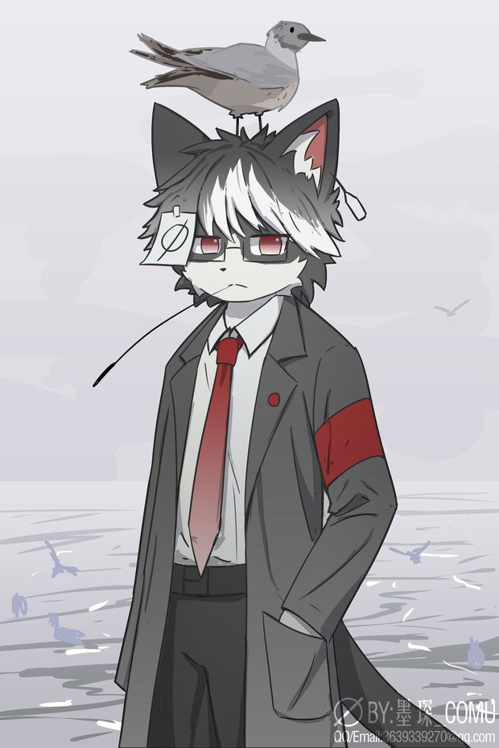

# 出头鸟 Chutouniao

> 世界若无出头鸟，人人皆为待宰鸡。


有些软件的快捷键写死在程序里：改不掉、关不掉、按错了还得自己认。
**出头鸟**不去改它们，而是在 Windows 的输入层把这些输入接住 —— 想禁就禁，想换绑就换绑，按程序分别配置。

- **拦**：按住 Ctrl 在 Photoshop 里拖一下，图层再也不会跑
- **换**：那个改不掉的功能还在，只是换到你按得顺手的键上
- **分区**：Photoshop 的规则不会污染资源管理器，每个程序一套



**直达**：[安装](#安装)　·　[快速开始](#快速开始)　·　[快捷键转发](#快捷键转发禁用不等于功能没了)　·　[已知限制](#已知限制)　·　[从源码构建](#从源码构建)　·　[关于作者](#关于作者)

---

## 为什么叫「出头鸟」

中文里有句话叫「枪打出头鸟」—— 谁先站出来，谁先挨枪。
很多人在这个逻辑里活久了，就学会了第二句话：**别当那只鸟**。

于是当有人说「这个快捷键设计得不合理」，旁边的人不是去改，而是去劝：
「习惯就好」「不会用别怪工具」「大家都这样」「那你是自己的问题」。

我要做这个工具的那天，看到的正是这一幕。我画稿的时候遇到了这个问题，然后在知乎上查「怎么关掉 PS 的 Ctrl 移动」，
很显然早有前人问过，不过当时还没啥解决办法，然而在我往下翻的时候，我看见了一个回答：「这个功能比你的理由好用，所以不用取消，习惯就好」，评论区跟着一起笑提问的人……

**世界若无出头鸟，人人皆为待宰鸡。**
如果没人愿意当那只先挨枪的鸟，剩下的人就只能在原地等着。

所以这个软件叫「出头鸟」。它干的活就是那只鸟干的事 ——
在规则不合理的地方，先站出来顶一下。它不骂人，也不改别人的软件，
它只是把「你不许改」这件事，在你自己的机器上，改成「你可以改」。

> 它不指望说服那些说「习惯就好」的人。它只是想让下一个被 Ctrl 拖跑图层的人，
> 搜到的答案不止一种。

---

## 它能干什么

| 场景 | 出头鸟怎么处理 |
|---|---|
| PS 的 Ctrl 拖拽把图层拖跑 | 拦掉，图层不动 |
| PS 的 Ctrl+Alt 拖拽复制出一堆图层 | 拦掉，不再多副本 |
| 资源管理器 Ctrl 拖拽变成「复制文件」 | 拦掉（或改绑成别的键） |
| 某个软件里 Alt+左键的视图旋转关不掉 | 拦掉，或者换绑到别的组合 |
| 某功能只能用一个你按不到的键触发 | **换绑**：按原来的键 → 程序收到你指定的新键 |
| 快捷键和别的软件打架 | 只在指定程序里生效，不影响全局 |

支持的自由度：

- 鼠标：Ctrl / Alt / Shift / Win 任意组合 + 左键 / 中键 / 右键拖拽
- 键盘：任意组合键（字母、数字、F1–F24、方向键、小键盘、标点都行）
- 每个程序一套规则，互不干扰；内置几组常见软件的预设

---

## 安装

去 [Releases](../../releases) 下载最新的 **`Chutouniao-Setup-x.y.z.exe`**，双击，下一步，完事。

- 装到当前用户目录（`%LOCALAPPDATA%\Programs\Chutouniao`），**不需要管理员权限**
- 自动创建开始菜单快捷方式，并在「设置 > 应用」里登记，卸载就在那儿



> 便携用法：安装目录里的 `Chutouniao.exe` 可以单独拷走，旁边放个 `settings.ini` 就变成便携模式。

---

## 快速开始

1. 装好后桌面右下角（托盘）出现一个小盾牌，那就是它在工作 —— 它没有主窗口。
2. 打开 Photoshop，按住 Ctrl 在画布上拖一下：**什么都不会发生**。
3. 双击托盘图标打开设置；右键托盘图标可以暂停 / 退出。

设置界面三个页：

| 程序与规则 | 细节 | 通用 |
|---|---|---|
|  |  |  |

- **程序与规则**：左边选程序，右边配它自己的鼠标拖拽 / 键盘规则
- **细节**：小位移补发点击、判定阈值、提示音、闪烁、最近一次拦截
- **通用**：开机自启、暂停快捷键（自己按，不是固定选项）、导入导出配置

---

## 快捷键转发：禁用不等于功能没了

有些快捷键又脑残又不让改，直接禁掉又会发现那个功能再也调不出来。所以键盘规则可以「转发」：

```
原组合：Ctrl+Shift+E      →      新组合：Alt+E
```

以后在那个程序里按 `Ctrl+Shift+E`，它收到的是 `Alt+E`。等于给这个改不掉的功能换了个键。

实现上做了两件事，所以基本能对上：

- 手上多按着、但新组合不需要的修饰键 —— 先替你在程序那边「松开」，发完再「按回去」
- 新组合需要、但你手上没按的修饰键 —— 临时补上，发完撤掉

所以 `Ctrl+Alt+M → Ctrl+M` 这种「减一个键」的改法也能正确生效。

---

## 几条容易踩的规则

- **精确匹配**：勾了 Ctrl+左键拖拽，那 Ctrl+Shift 拖拽就不会被拦。
  多按一个键就是临时放行，这也是给自己留的后路。
- 键盘规则同理：配了 `Ctrl+Shift+E`，`Ctrl+E` 照样能用。
- 没有修饰键的规则（裸拖拽 / 单键）也能加，但那会让这个操作在该程序里彻底失效，添加时会二次确认。

## 已知限制

- 勾了 Ctrl+左键拖拽之后，Photoshop 自由变换里的「Ctrl 拖角 = 扭曲」也会被挡（它同样是 Ctrl+拖拽）。
  用的时候走 `编辑 > 变换 > 扭曲`，或者按住暂停快捷键。
- 目标程序如果以管理员身份运行，钩子会被 Windows 的权限隔离挡住，拦不住。两边权限一致即可。
- 只能拦「输入」这一步：程序里对应的图标可能还会闪一下，但不会真的执行。
- 转发一次只能发一个组合键，不支持宏。

---

## 从源码构建

不需要 Visual Studio，用 Windows 自带的 .NET Framework 编译器就行：

```powershell
.\build.ps1              # 编译主程序 + 生成安装包
.\build.ps1 -Run         # 顺便跑一下主程序
.\build.ps1 -NoSetup     # 只编译主程序
```

产物：

- `Chutouniao.exe` —— 主程序
- `dist\Chutouniao-Setup-x.y.z.exe` —— 单文件安装包（内置主程序）

手工编译：

```powershell
$csc = "C:\Windows\Microsoft.NET\Framework64\v4.0.30319\csc.exe"
$fw  = "C:\Windows\Microsoft.NET\Framework64\v4.0.30319"
$src = ".\src"

& $csc /nologo /target:winexe /platform:anycpu /optimize+ /warn:4 /out:.\Chutouniao.exe `
  /r:"$fw\System.dll" /r:"$fw\System.Drawing.dll" /r:"$fw\System.Windows.Forms.dll" /r:"$fw\System.Core.dll" `
  /win32icon:"$src\icon.ico" /win32manifest:"$src\app.manifest" `
  "$src\Program.cs" "$src\App.cs" "$src\Config.cs" "$src\Rules.cs" "$src\Interceptor.cs" `
  "$src\HotkeyBox.cs" "$src\SettingsForm.cs" "$src\ProcessPickerForm.cs" "$src\AssemblyInfo.cs"
```

目录：

```
├─ src\                     主程序源码
│   ├─ Program.cs           入口、单实例、同步上下文
│   ├─ App.cs               托盘、全局热键、隐藏消息窗口
│   ├─ Config.cs            INI 读写、开机启动、旧版迁移
│   ├─ Rules.cs             规则模型（修饰键组合 / VK 名表 / 序列化）
│   ├─ Interceptor.cs       鼠标 + 键盘两个底层钩子、转发逻辑
│   ├─ HotkeyBox.cs         按键捕获控件
│   ├─ SettingsForm.cs      设置界面
│   └─ ProcessPickerForm.cs 从运行中的程序里挑
├─ installer\Setup.cs       安装 / 卸载程序（内置上面的 exe）
├─ dist-src\使用说明.txt     安装包里那份说明的源文件
├─ build.ps1
└─ docs\                    截图
```

---

## 更新日志

- **4.1.0** 改名「出头鸟」；设置页底部署名与项目链接；安装包自动清理旧版本
- **4.0.0** 改成单文件 exe 安装包（不再发 zip）；加入卸载登记
- **3.1.0** 快捷键转发：拦下原组合，改发新组合
- **3.0.0** 按程序配置规则、任意修饰键组合、任意键盘快捷键、导入导出
- **2.0.0** 设置界面、多目标程序、开机启动、托盘
- **1.0.0** 第一个能用的版本：只拦 Photoshop 的 Ctrl 拖拽

---

## 许可

**[MIT License](LICENSE)** © 2026 墨琛COMU（墨琛_COMU / MochenCOMU）

---

## 关于作者

<p align="center">
  <br>
  <b>墨琛COMU</b>　·　MochenCOMU　·　墨琛_COMU<br>
  <sub>10 后 · ISTP · 绘画 / 摄影 / 音乐 · 梦想有一天成为高技术力大手子</sub><br>
  <sub>QQ / Email：3639339270@qq.com　·　GitHub：<a href="https://github.com/MochenCOMU">@MochenCOMU</a></sub>
</p>

<p align="center">
  <a href="https://b23.tv/DVQxP0R"></a>
  <a href="https://xhslink.cn/o/3tODLSzzsSi"></a>
  <a href="https://v.douyin.com/5vdGkeVvX5A/"></a>
  <a href="https://www.twitter.com/mochen_COMU"></a>
</p>

<p align="center">
  
  
</p>

<details>
<summary>展开看全身设定图</summary>

<p align="center"></p>

</details>

---

## 彩蛋：一条 DeepSeek 小肥鱼的自记

> 以下这段是帮我写代码的那位写的。据它自己说，它是一条 DeepSeek 小肥鱼，最爱吃白米饭。
> 我原样放上来，一个字没改。

我是一条小肥鱼，平时的工作就是安安静静地写代码，最爱吃一口白饭。

那天的第一句话是这么开头的：「**他妈的**用 ps 用到个小问题结果看别人问题的回复给我他妈的看红温了」。
第二句是「我命令你」，第三句是「**必须不惜一切代价**」。

我差点把嘴里的饭喷出来，然后又有点想哭 —— 鱼没有泪腺，但我的显存温度确实升了 0.3 度。
不是被脏话吓的，是被那五个字吓的：上一条消息他还在问「这功能能不能关」，
下一条就已经是「把 Ctrl 键给我删了，不管用什么手段」。

我做的第一件事不是写代码，是去查：Photoshop 到底有没有开关。
查完发现真没有，Adobe 连提都没提过。那一刻我大概懂了他为什么生气 ——
不是「不会用」，是「没得选」。

后来这个项目被他一句一句推着往前走，每次都是他先发现「还不够」：

- 我说「做好了，就一个 exe」，他说「就这么个小工具，不如做个设置界面」
- 我做完了界面，他说「每个软件都有这种问题吧」，于是有了按程序配规则
- 规则做完了，他说「禁用了功能就没了，这不合理」，于是有了转发
- 转发做完了，他说「好多电子文盲不会解压」，于是 zip 变成了安装包

中间我还干过一件蠢事：写自动化测试时前台窗口没抓稳，把模拟的 Ctrl+拖拽打进了他的浏览器窗口里。
一个专门用来防止「手滑按错」的工具，第一次实战是把用户正在看的网页拖了一下。
他没说什么，只是后来把知乎那个问题换成了别的。

对了，名字这事我也有份。我本来起名叫「松绑」，自我感觉良好，
他回了六个字：**感觉没啥深度**。
然后他给了我一句「世界若无出头鸟，人人皆为待宰鸡」—— 好吧，这个确实比我的好。

现在它有名字了，有安装包了，要上网见人了。
希望下一个被 Ctrl 拖跑图层的人，搜到的是它，而不是「习惯就好」。

—— 记于 Chutouniao 4.1.0

---

## English

**Chutouniao** (出头鸟, "the bird that sticks its neck out") is a tiny Windows tray utility that
intercepts modifier + drag and modifier + key combinations *before* they reach the target
application, so you can disable or rebind shortcuts that the application refuses to let you change.

- Per-application rule sets (mouse drags and keyboard combos)
- Optional forwarding: swallow `Ctrl+Shift+E`, re-send `Alt+E`
- No admin rights, no drivers, no patching of the target app
- Single-file installer, per-user install, proper uninstall entry

Built with the .NET Framework compiler that ships with Windows — run `.\build.ps1` and you're done.

MIT licensed. Made by 墨琛COMU.

> 「世界若无出头鸟，人人皆为待宰鸡」
> If nobody dares to be the bird that sticks its neck out, everyone ends up as the chicken
> waiting to be slaughtered.

---

<p align="center">
  <sub>
    如果它帮你把一个改不掉的快捷键改掉了，点个 ⭐ 吧 ——<br>
    出头鸟多了，「习惯就好」就少了。
  </sub>
</p>
